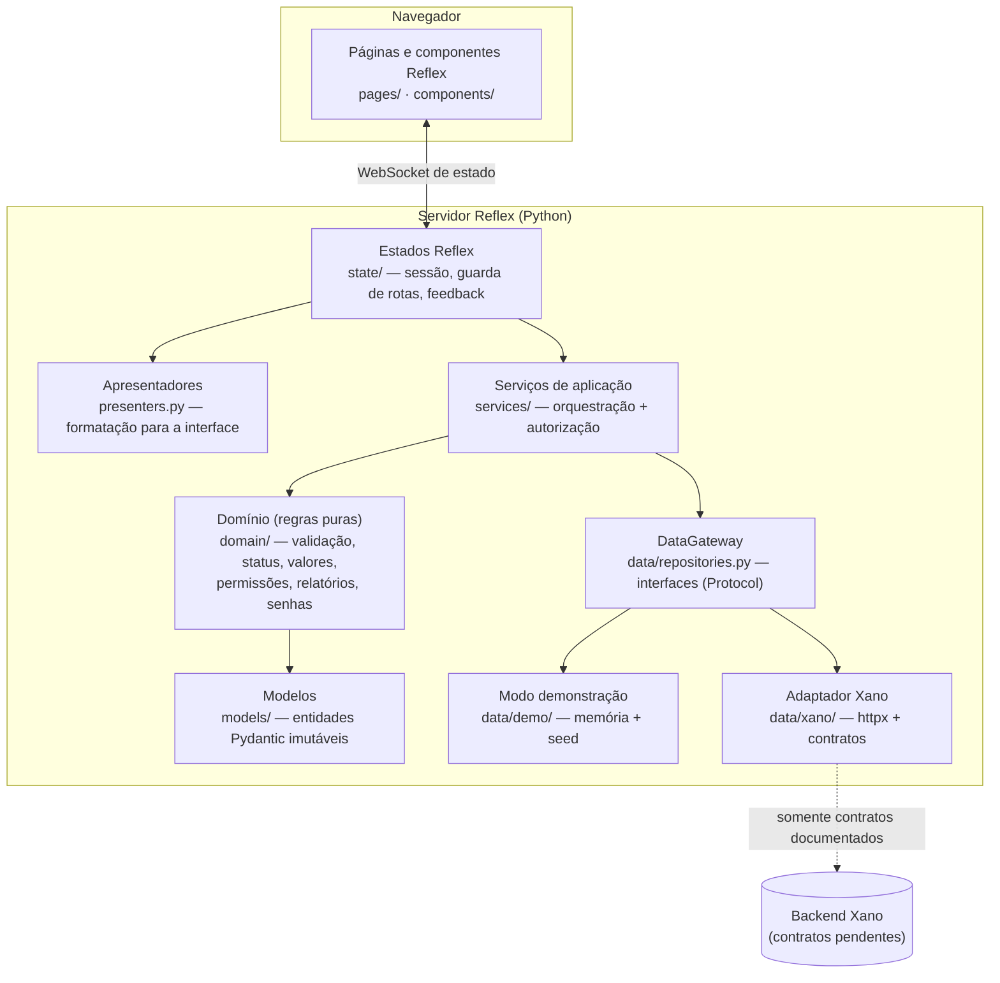
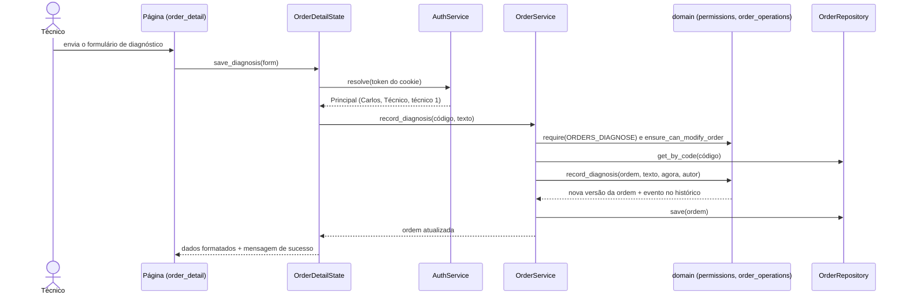

# Arquitetura

Visão técnica do Assistência TECH: como o código está organizado, como uma operação atravessa as camadas e quais decisões sustentam a solução. As decisões detalhadas, com alternativas consideradas, estão nos `design.md` de cada mudança, em `openspec/changes/` (em andamento) e `openspec/changes/archive/` (concluídas).

## Visão geral em camadas



| Camada | Responsabilidade | Depende de |
|---|---|---|
| `pages/`, `components/` | Composição visual, sem regra de negócio | `state/` |
| `state/` | Sessão (cookie), guarda de rotas, carregamento, mensagens | `services/`, `presenters.py` |
| `presenters.py` | Converte entidades em textos prontos (R$, CPF, datas) | `domain/`, `models/` |
| `services/` | Orquestra cada operação: valida entrada, verifica permissão, aplica regra, grava | `domain/`, `data/` |
| `domain/` | Regras de negócio puras e testáveis, sem I/O | `models/` |
| `models/` | Entidades e validação de formato (Pydantic, imutáveis) | `domain/validators.py` |
| `data/` | Persistência atrás de interfaces; demonstração e Xano | `models/` |

Regra de dependência: as camadas internas (`domain`, `models`) não conhecem Reflex, HTTP ou a fonte de dados. Por isso as regras valem igualmente para o modo demonstração e para o Xano e são testadas sem navegador.

## Fluxo de uma operação

Exemplo: o técnico registra o diagnóstico de uma ordem.



Se qualquer verificação falhar, o serviço lança um erro da hierarquia `DataAccessError` (`ValidationError`, `PermissionDeniedError`, `AuthenticationError`, `NotFoundError`, `ServiceUnavailableError`, `ContractPendingError`...). O estado exibe a `user_message` do erro, que nunca contém detalhes técnicos, e nada é gravado.

## Organização do código

```
assistencia_tech/
  assistencia_tech.py      # cria o app e registra as rotas
  config.py                # variáveis de ambiente (fonte de dados, Xano)
  presenters.py            # formatação para a interface
  models/                  # entities.py, users.py, validation.py
  domain/                  # validators, order_workflow, order_operations, pricing, history,
                           # permissions, passwords, login_throttle, staff_rules, reports, csv_export, clock
  services/                # auth, clients, equipment, orders, portal, staff, reports, catalog
  data/                    # repositories (interfaces), errors, factory, sessions
    demo/                  # gateway em memória, seed, usuários e autenticação de demonstração
    xano/                  # client (httpx), contracts (registro vazio), gateway
  state/                   # base, clients, equipment, orders, order_detail, portal, public, admin
  pages/                   # public, dashboard, clients, equipment, orders, order_detail, portal, admin
  components/              # layout, ui, dialogs
tests/                     # testes por camada + roteiro de demonstração
openspec/                  # especificações e mudanças (processo spec-driven)
```

Todos os arquivos Python ficam abaixo de 350 linhas (limite do projeto: 1000).

## Decisões principais

| Decisão | Motivo | Onde |
|---|---|---|
| Padrão Repository com `Protocol` e `DataGateway` | Trocar demonstração por Xano sem alterar páginas nem regras | `openspec/changes/integrate-xano-backend/design.md` D1 |
| Registro explícito de contratos do Xano, vazio | Impede inventar endpoints; operações sem contrato falham sem enviar requisições | idem D5 |
| Regras em funções puras + serviços de aplicação | Regras testáveis e reaproveitadas por qualquer fonte de dados | `openspec/changes/archive/2026-11-06-expand-service-domain/design.md` D1 |
| Ordem de serviço como agregado imutável | Itens, pagamentos e histórico sempre consistentes; histórico só cresce | idem D2 |
| Status e transições como tabela de dados | Regras visíveis, verificáveis e usadas também para montar a interface | idem D4 |
| `Decimal` para dinheiro | Sem erros de arredondamento de `float` | idem D5 |
| Matriz de permissões única, aplicada nos serviços | A interface esconde ações, mas a proteção real está no servidor | `openspec/changes/archive/2026-11-06-add-auth-and-access-control/design.md` D5–D6 |
| Sessão no servidor com token opaco | Revogável no logout e na desativação; nenhum dado pessoal no navegador | idem D3 |
| Relatórios como funções puras sobre o agregado | Números verificáveis por teste com dados conhecidos | `openspec/changes/archive/2026-11-06-add-admin-and-reports/design.md` D5 |

## Segurança

- **Autenticação:** PBKDF2-SHA256 com sal e 600.000 iterações; comparação em tempo constante; mensagem genérica; tempo equalizado para e-mails inexistentes; bloqueio após 5 tentativas.
- **Sessão:** token aleatório de 32 bytes em cookie `SameSite=Strict`; expiração após 2 h sem atividade; revogação no logout e na desativação da conta.
- **Autorização:** verificada em cada serviço (`require`) e no carregamento de cada página (`_guard`), antes de qualquer dado ser enviado; o técnico só altera as próprias ordens.
- **Privacidade:** a consulta pública usa uma projeção sem dados pessoais (`PublicOrderView`); o portal só retorna ordens do próprio cliente e responde "não encontrada" para as demais; o CPF é mascarado no portal.
- **Redirecionamento:** o parâmetro `proximo` só aceita caminhos internos.
- **Configuração:** nenhuma credencial versionada; variáveis em `.env.example`.
- **Limitação conhecida:** o cookie não é `HttpOnly`, porque o Reflex lê cookies no navegador.

## Estratégia de testes

| Nível | O que cobre | Arquivos |
|---|---|---|
| Domínio | Validadores, transições, valores, histórico, permissões, senhas, limitador, relatórios, CSV | `test_validators`, `test_order_rules`, `test_auth_domain`, `test_reports_domain` |
| Modelos | Validação e mensagens em português | `test_models` |
| Serviços | Cenários das specs com perfis reais, inclusive recusas | `test_services`, `test_auth_services`, `test_staff_reports_services` |
| Dados | Contrato interno do modo demonstração, fábrica, configuração, cliente Xano com `httpx.MockTransport` | `test_demo_gateway`, `test_factory`, `test_config`, `test_xano` |
| Apresentação | Formatação, filtros, permissões exibidas, dados dos gráficos | `test_presenters`, `test_safe_redirect` |
| Ponta a ponta | O roteiro de demonstração inteiro, pelos serviços | `test_demo_script` |

As camadas de interface (páginas e estados Reflex) foram verificadas no navegador, com registro em cada `tasks.md`. Elas não têm testes automatizados, e isso aparece na cobertura total (ver `ACADEMIC_REPORT.md`).
