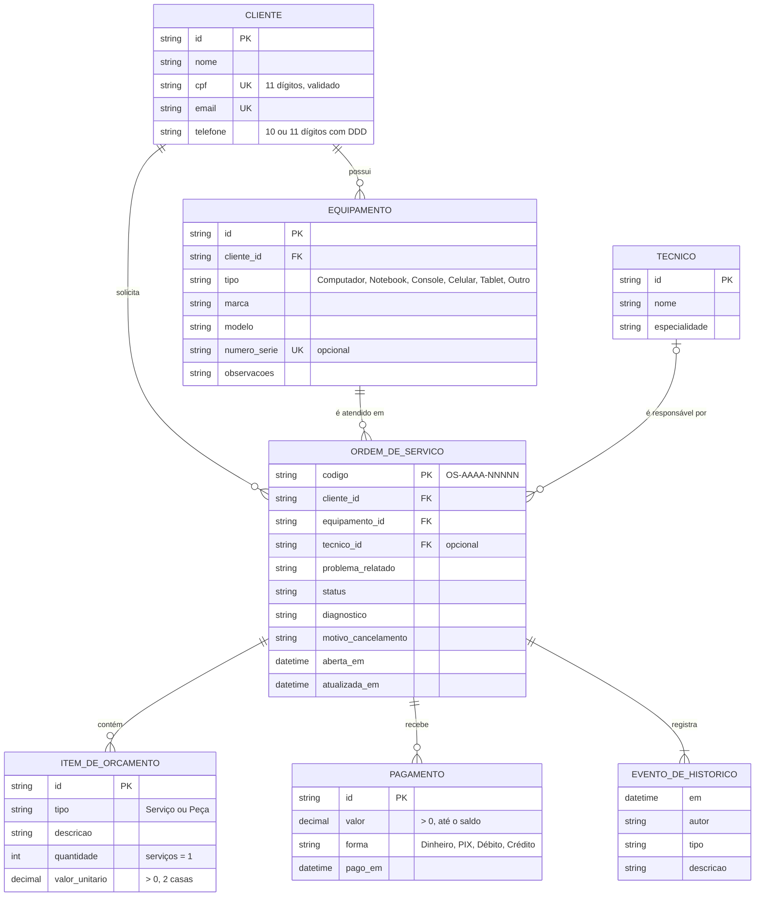
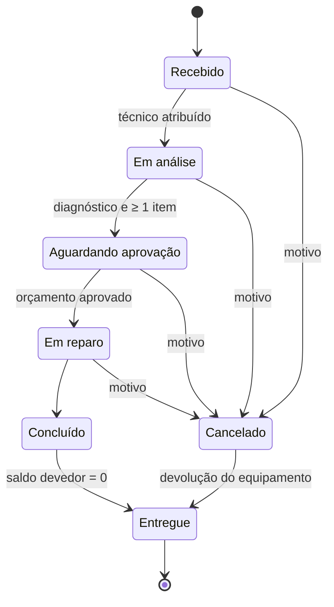

# Modelo de dados

Modelo de domínio do Assistência TECH, definido em `assistencia_tech/models/entities.py` e especificado pelas capacidades `client-management`, `equipment-management` e `service-orders` (mudança `expand-service-domain`).

> O modelo é **interno** à aplicação. A estrutura das tabelas no Xano será mapeada para ele somente quando a documentação oficial da API for fornecida (ver `XANO_INTEGRATION.md`).

## Diagrama entidade-relacionamento

### Regras de integridade

| Regra | Onde é garantida |
|---|---|
| CPF válido e único; e-mail único | `ClientCreate` (formato) e `services/clients.py` (unicidade) |
| Cliente com equipamentos ou ordens não pode ser excluído | `ClientService.delete` |
| Número de série único quando informado | `EquipmentService` |
| Equipamento com ordens não troca de cliente nem é excluído | `EquipmentService.update` / `delete` |
| Equipamento da OS pertence ao cliente da OS | `OrderService.open` |
| Itens, pagamentos e histórico pertencem à OS (agregado) | `ServiceOrder` (tuplas imutáveis) |
| Histórico só recebe novos eventos | `domain/history.py` (`append`) |

## Ciclo de vida da ordem de serviço

- Diagnóstico e orçamento podem ser alterados em **Em análise**, **Aguardando aprovação** e **Em reparo**.
- O técnico pode ser trocado enquanto a ordem não estiver **Entregue** ou **Cancelada**.
- Pagamentos são aceitos em ordens não canceladas, até o saldo devedor.
- A tabela de transições está em `domain/order_workflow.py` (`TRANSITIONS`) e é coberta por `tests/test_order_rules.py`.

## Valores

`total = Σ serviços + Σ (quantidade × valor unitário das peças)`; `saldo = total − Σ pagamentos`. A situação do pagamento é **Pendente** (nada pago), **Parcial** ou **Pago**. Ordens canceladas sem pagamento aparecem como **Não se aplica**. Valores usam `Decimal` arredondado em centavos e são exibidos como `R$ 1.234,56`.
