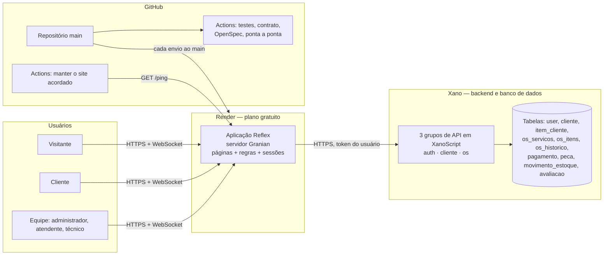

# Visão do sistema publicado

Como o Assistência TECH funciona em produção: quem conversa com quem, onde cada regra mora e como uma mudança chega ao ar. Para as camadas internas do código, veja `ARCHITECTURE.md`.

## Componentes

- **Navegador ↔ aplicação:** as páginas conversam com o servidor por WebSocket. O navegador guarda só um identificador de sessão; o token do Xano fica no servidor.
- **Aplicação ↔ Xano:** cada chamada usa o token do próprio usuário. Não existe credencial "do sistema" no código, no repositório nem no Render.
- **GitHub → Render:** cada envio ao `main` reconstrói a imagem Docker e publica. O site é compilado na construção; ao iniciar, sobe só o servidor (cabe nos 512 MB do plano gratuito).

## Onde cada regra é aplicada

| Regra | Aplicação (Python) | Xano (XanoScript) |
|---|---|---|
| Perfis e permissões | `domain/permissions.py`, verificado em todo serviço | `atech_usuario_autorizado` em todo endpoint |
| Fluxo de status da ordem | `domain/order_workflow.py` | `PATCH /os_servicos/{id}` |
| Entrega só com a ordem quitada | `domain/order_operations.py` | `atech_saldo_da_os` |
| Aprovação ou recusa do orçamento pelo cliente | `services/portal.py` | `POST /portal/decisao_orcamento` (transação) |
| Baixa e devolução de peças do estoque | `domain/inventory.py` | `atech_mover_estoque` (transação) |
| Previsão de entrega e garantia de 90 dias | `domain/deadlines.py` | `atech_garantia_valida` |
| Avaliação única por ordem entregue | `domain/rating.py` | `POST /portal/avaliacao` + índice único |
| Exclusão da conta pelo titular (LGPD) | `domain/privacy.py` | `POST /portal/excluir_conta` (transação) |
| Dados públicos sem informação pessoal | projeções no presenter | `consulta_publica`, `estatisticas_publicas` |

As regras ficam nos dois lados de propósito: a aplicação responde rápido e com mensagens claras, e o backend é a barreira final — quem chamar a API diretamente encontra as mesmas recusas.

## Capacidades e onde estão especificadas

Cada capacidade tem uma especificação em `openspec/specs/<nome>/spec.md`, com requisitos e cenários. As mudanças que as criaram estão em `openspec/changes/archive/`, com o registro do que foi testado.

| Capacidade | O que cobre |
|---|---|
| `user-auth`, `access-control` | login, cadastro, sessões, perfis e permissões |
| `client-management`, `equipment-management` | clientes e equipamentos |
| `service-orders` | ordens, status, orçamento, pagamentos, prazos, garantia, consulta pública |
| `orders-board` | quadro Kanban |
| `inventory` | estoque de peças |
| `customer-portal` | portal do cliente e decisão do orçamento |
| `order-receipts` | comprovantes com QR code |
| `service-rating` | avaliação e NPS |
| `privacy` | exportação e exclusão de dados (LGPD) |
| `operational-reports` | relatórios, evolução mensal, CSV e PDF |
| `admin-dashboard`, `staff-management` | painel e colaboradores |
| `public-site` | página inicial com números reais e página de serviços |
| `backend-integration`, `data-source` | adaptadores do Xano e modo demonstração |
| `continuous-integration`, `public-deployment` | CI e publicação |
| `design-system`, `responsive-interface` | identidade visual, acessibilidade e celular |

## Qualidade

- **Testes automáticos** (`pytest`): regras de domínio, serviços, adaptador do Xano com servidor simulado, regras do projeto (arquivos com menos de 1.000 linhas, nenhum segredo versionado).
- **Contrato com o Xano:** `python -m tools.xano_contract_check` compara a documentação publicada pelo Xano com o contrato que a aplicação espera.
- **Ponta a ponta:** `e2e/` abre o site num navegador real e percorre os fluxos principais, inclusive pelo teclado.
- **Integração contínua:** tudo isso roda no GitHub a cada envio, sem segredos.

## Limites conhecidos do ambiente gratuito

- O Render dorme após 15 minutos sem acesso; um workflow agendado o mantém acordado em horário comercial.
- O Xano gratuito aceita 10 requisições a cada 20 segundos; a aplicação guarda leituras por 15 segundos e espaça as chamadas.
- As sessões ficam na memória do servidor: reiniciar o site pede novo login.
